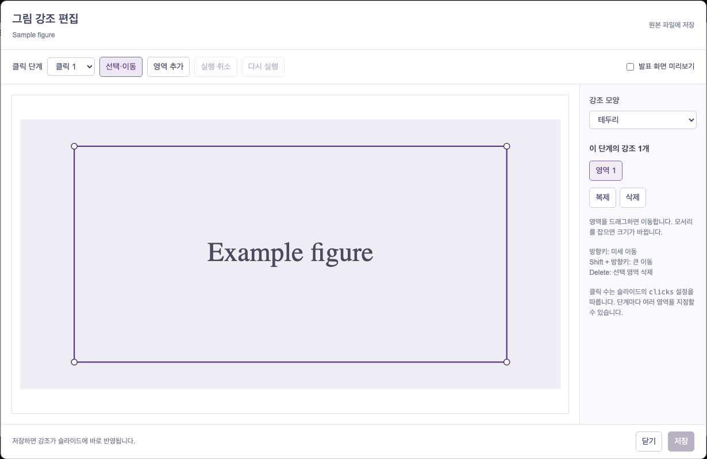

# Slidev Authoring

Markdown citations, a visual figure-highlight editor, and PowerPoint export for Slidev. Annotations and bibliography data are stored in the deck.

**Requirements:** Node.js 22.12+ and Slidev 52.19.1. Tested with Vue 3.5 and Vite 8.2.2.

[Setup](#setup) · [Editing](#edit-highlights) · [PowerPoint](#export-to-powerpoint) · [Configuration](#configuration)

## Setup

### 1. Install the addon

```sh
npm install -D github:seonjunn/slidev-authoring
```

Commit `package-lock.json` to pin the installed revision.

### 2. Enable it in the deck

Add the addon to the first frontmatter block in `slides.md`:

```yaml
addons:
  - slidev-addon-authoring
```

Create `vite.config.ts` beside `slides.md`:

```ts
import { fileURLToPath } from 'node:url'
import { authoring } from 'slidev-addon-authoring/vite'

export default authoring({
  root: fileURLToPath(new URL('.', import.meta.url)),
})
```

### 3. Add the deck data

| File | Contents |
| --- | --- |
| `public/figures/` | Images displayed in slides |
| `annotations.json` | Start with `{}`; the editor writes highlights here |
| `references.json` | Bibliography entries keyed by citation number |

Example `references.json`:

```json
{
  "1": {
    "authors": "Author et al.",
    "title": "Paper title",
    "venue": "Conference 2026"
  }
}
```

### 4. Write Markdown

```md
---
contentId: example
clicks: 1
---

# A concise claim

- Supporting evidence belongs beside its citation. [1]


```

`[1]` becomes a superscript citation and a bibliography footer. An image under `/figures/` becomes an editable figure. Use a layout with a figure area, or set a height for `.authoring-visual` in the deck's CSS.

## Edit highlights

1. Start the deck's Slidev dev server and open a slide containing a figure.
2. Hover over the figure and select **그림 강조 편집**.
3. Choose the click step, then select an existing region or add one.
4. Drag to move a region; use its corner handles to resize it.
5. Choose a preset or a custom color for the selected region. Select **그림 기본색 편집** to change the default across click steps.
6. Preview the result and select **저장** to save.



*The screenshot uses a sample image. The editor's current interface is Korean.*

| Control | Action |
| --- | --- |
| **클릭 단계** | Select a click step |
| **영역 추가** | Draw a new region |
| **실행 취소** / **다시 실행** | Undo / redo |
| **발표 화면 미리보기** | Preview without editing handles |
| **강조 모양** | Choose a translucent fill or an outline |
| **영역 색상** / **그림 기본색** | Use purple, blue, teal, amber, rose, or a custom color |
| **사용자 지정** | Use the color picker or enter a six-digit `#RRGGBB` value |
| **그림 기본색 사용** / **테마 색상 사용** | Remove a region override / restore the theme default |
| **저장** / **변경 버리기** | Save / discard changes |
| Arrow keys / Shift + arrow keys | Move a region in small / larger increments |

Saving updates `annotations.json`. A stable `contentId` keeps highlights attached to a slide when it is reordered. Concurrent edits to the same figure are checked before saving.

Colors can distinguish different roles within the same figure. A region color affects only that region in that click step. A figure default affects all regions without an override, across all steps. Changing colors supports undo/redo and keeps coordinates unchanged. Existing annotations inherit the theme color.

### Annotation colors

The original `[x, y, width, height]` regions remain valid. A fifth value overrides a region's color; optional `focusColor` sets the figure default. Colors are six-digit hex values. Both fills and outlines use them.

```json
{
  "example": {
    "src": "/figures/example.png",
    "ratio": 2,
    "focusStyle": "wash",
    "focusColor": "#7655AB",
    "regions": [[], [[10, 20, 30, 40, "#21877E"], [55, 20, 30, 40]]]
  }
}
```

### Editing scope

- One editable figure per `contentId`, with up to 40 click states.
- Set `clicks` in Markdown before editing highlight steps. Each step stores its own regions.
- Check alignment after changing a figure's crop or dimensions.
- Mermaid structure is edited in its source file.

The local dev server provides the editor and save endpoint. Static builds contain the figures, highlights, and citations. Slidev provides the **Slide** and **Notes** editors separately.

## Export to PowerPoint

`slidev-pptx` converts a deck into an editable `.pptx` and writes a report of what it could not convert.

```sh
npm install -D playwright-chromium
npx playwright install chromium
npx slidev-pptx slides.md -o deck.pptx
```

It starts the deck's Slidev dev server, reads every slide at every click step in Chromium, and writes:

| Output | Contents |
| --- | --- |
| `deck.pptx` | Text boxes with real bullets, native tables, shapes and connectors for diagrams, pictures, Office equations, speaker notes, sections, and click animations |
| `deck.report.md` and `deck.report/` | Items to fix by hand, places where the shape check disagrees with the browser, and things to confirm in PowerPoint |

### Click steps

Each Slidev click becomes one PowerPoint click.

- A highlight that changes only colour or weight is an emphasis effect on a single shape, so its text is edited once.
- A shape whose text changes between clicks becomes stacked copies that appear and disappear. Edit every copy; the report lists the slides.
- A heavier outline is a separate outline shape drawn over the original while it applies.

### The report

| Section | Meaning |
| --- | --- |
| Items to fix | Content the converter dropped or replaced with a picture: rotated elements, inset shadows, `::before`/`::after` content, background images, `<canvas>`/`<video>`/`<iframe>`, SVG gradient fills. Each item has a crop of the original slide. |
| Shape check | Click steps whose LibreOffice rendering differs from the browser by more than the threshold, shown side by side |
| Confirm in PowerPoint | Approximations, font substitutions, equations, Korean text, stacked copies, and the animations themselves |

Give the report and the PPTX to a person or an agent to finish the items. Shape names in the report match the PowerPoint Selection Pane.

### Shape check

The check draws every click step with LibreOffice: a local `soffice` with `pdftoppm`, otherwise Docker. The Docker image `slidev-authoring-libreoffice:1` is built on first use, which takes several minutes. Without either, the check is skipped and the report says so.

The check compares where each click step should end up. It does not play the animations, and LibreOffice cannot draw Office equations, so equations are excluded. Before presenting, step through the slide show in PowerPoint.

### Options

| Option | Purpose |
| --- | --- |
| `-o, --out <file>` | Output path. Default: `<deck folder>.pptx` |
| `--slides <range>` | Convert part of the deck, such as `1-5,8` |
| `--url <url>` | Use a Slidev server that is already running |
| `--trail <selector>` | Element shown in the layout's small header placeholder, such as a breadcrumb |
| `--profile hcs\|generic` | Slide frame. Default: `hcs` for `slidev-theme-hcs`, otherwise `generic` |
| `--no-check` | Skip the shape check |
| `--threshold <percent>` | Difference that marks a click step in the shape check. Default: `3` |
| `--strict` | Exit with code 2 when items need fixing |

`pptx.trail` in the first frontmatter block sets `--trail` for the deck.

### Themes and fonts

Decks on `slidev-theme-hcs` get a matching master with title, section, title-only, and closing layouts, including the footer and slide numbers. Other themes use a generic frame: titles become title placeholders and the rest of the slide stays as shapes.

Text is laid out with fonts metric-compatible with the PowerPoint fonts it maps to, so line breaks match. Other families map to Arial, Georgia, or Consolas; the report lists each substitution.

## Configuration

### Deck files

Paths are relative to `root` and must stay inside it.

| Option | Default | Purpose |
| --- | --- | --- |
| `root` | Required | Absolute deck directory |
| `entry` | `slides.md` | Slide source |
| `annotations` | `annotations.json` | Highlight data |
| `references` | `references.json` | Bibliography |

### Markdown extensions

| Option | Purpose |
| --- | --- |
| `renderImage({ src, caption, escape })` | Return custom markup for a deck-specific image, or `undefined` to use the editable figure. |
| `markdownSetup(md)` | Add deck-specific Markdown rules after the addon. |

### Appearance

Set CSS variables in the deck to match its theme:

```css
:root {
  --authoring-highlight: #7655ab;
  --authoring-reference-inset: 40px;
  --authoring-reference-bottom: 20px;
  --authoring-reference-size: 11px;
  --authoring-caption-size: 15px;
}
```

`.authoring-visual` fills its parent by default. The theme defines the surrounding slide layout.

## Development

```sh
npm ci
npm test
npm pack
```

The package ships Vue source directly. Usage screenshots in `guide/` belong to the repository documentation and are excluded from the npm package.
